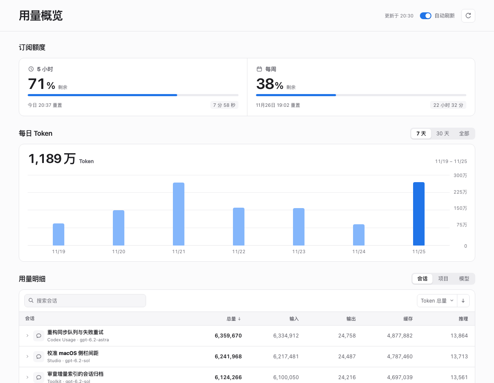
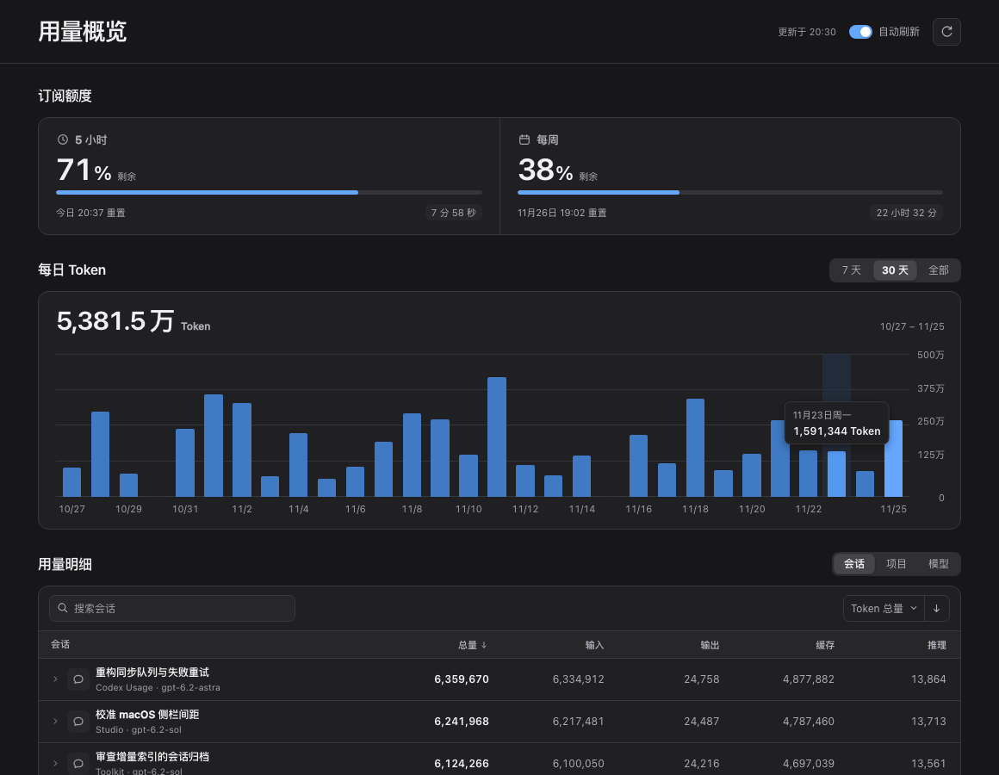
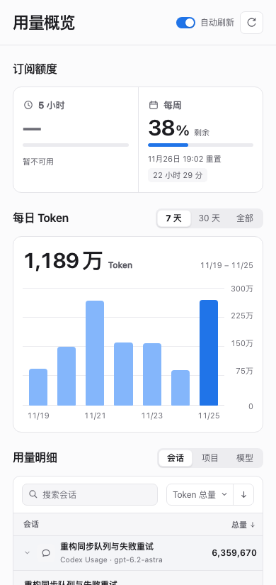

# Codex Usage

Codex Usage 是一个面向 macOS 上 Codex 桌面端的本地用量仪表盘。它把订阅额度和本机 Token 统计放在一个页面里，适合查看额度何时重置、比较每天的消耗，或找出用量较高的会话、项目和模型。固定到 Codex 侧栏后，点一下即可打开。



截图截自插件界面，使用模拟额度、项目和会话，仅保留仪表盘区域，图片元数据已移除。

<details>
<summary>查看深色和窄窗界面</summary>





</details>

## 安装方法

### 1. 准备环境

- 安装 macOS 版 ChatGPT 桌面客户端并切换到 Codex。需要支持本地插件市场和 Sidebar Apps 的客户端。订阅额度需要在 Codex 中登录可用的 ChatGPT 账号。
- 准备 Git 和支持 `codex plugin` 的 Codex CLI。桌面客户端默认安装在「应用程序」时，可以使用它随附的 CLI 和 Node。若把客户端装在其他位置，请确保终端能找到 Codex CLI 和 Node.js 24 或更高版本。
- 插件可直接运行，无需安装 npm 依赖，也无需 API 密钥。

在终端执行下面的命令。安装过程中请使用同一个终端窗口。

```sh
codex_cli="$(command -v codex || true)"
if [ -z "$codex_cli" ]; then
  codex_cli="/Applications/ChatGPT.app/Contents/Resources/codex-cli/CodexCLI.app/Contents/MacOS/codex"
fi
"$codex_cli" --version
"$codex_cli" plugin --help
```

如果找不到 CLI，先更新桌面客户端，或安装官方 Codex CLI 后重试。 [Codex CLI 安装指南](https://developers.openai.com/codex/cli)

### 2. 下载并安装插件

```sh
mkdir -p "$HOME/Projects"
git clone https://github.com/whiteMo0623/codex-usage.git "$HOME/Projects/codex-usage"
cd "$HOME/Projects/codex-usage"
"$codex_cli" plugin marketplace add "$PWD"
"$codex_cli" plugin add codex-usage@codex-usage-local
"$codex_cli" plugin list --marketplace codex-usage-local --json
```

最后一条命令应列出 `codex-usage@codex-usage-local`，且 `installed` 和 `enabled` 都为 `true`。如果使用了其他克隆目录，将 `cd` 的路径换成该目录。插件市场会引用这份工作副本，请保留目录以便以后更新。

### 3. 打开并固定侧栏入口

1. 在桌面客户端切到 Codex，打开 [Codex Usage 仪表盘](codex://plugins/codex-usage@codex-usage-local/app/dashboard)。也可以在终端执行 `open 'codex://plugins/codex-usage@codex-usage-local/app/dashboard'`。
2. 如果第一次打开时入口尚不可用，点击「重试」。若问题持续，退出并重新打开桌面客户端，再打开仪表盘。
3. 在仪表盘右上角的「更多插件操作」菜单选择「固定到侧栏」。以后从左侧导航点击 **Codex Usage** 即可，无需创建聊天。

## 使用说明

| 想查看什么 | 怎么操作 |
| --- | --- |
| 还剩多少订阅额度，什么时候重置 | 查看顶部的「5 小时」和「每周」。可用窗口会显示剩余百分比、重置时间和倒计时。 |
| 最近哪天用量最高 | 在「每日 Token」选择「7 天」或「30 天」，将光标移到柱子上查看当日精确数值。「全部」覆盖本机可读历史，日期较多时可横向滚动。 |
| 某段会话用了多少 Token | 在「用量明细 → 会话」搜索会话名、项目名或模型名，按总量、输入、输出、缓存、推理或最近活动排序。点开一行看完整数据。 |
| 哪个项目或模型消耗较多 | 切换「项目」或「模型」，按「Token 总量」降序查看。这里查询全部本地历史。 |
| 刚运行完任务，想看最新统计 | 点击右上角的刷新按钮。打开「自动刷新」后，仪表盘可见时每分钟更新一次。 |

订阅额度由官方 Codex App Server 返回。账号未提供某个窗口时，该窗口显示「暂不可用」。Token 图表和明细来自本机的 Codex 会话及归档，按本机时区统计。缓存命中计入输入，推理计入输出，查看总量时无需再次加上这两项。云端独有的会话和已删除的本地日志不会出现在历史统计中。

## 如何让你的 Codex 帮你安装

把下面这段话复制到你电脑上的 Codex 聊天中发送。此仓库的地址已经填好，安装其他副本时把链接替换成对应的 GitHub 仓库地址。如果你希望下载到其他目录，在末尾补上一句「请克隆到 `<目标目录>`」，并替换占位符。

```text
请帮我在这台 Mac 上安装 Codex Usage：https://github.com/whiteMo0623/codex-usage
请先读取 README，检查安装前提，再按「安装方法」下载、注册本地插件市场、安装插件并验证安装状态。
安装成功后请尝试打开仪表盘，并告诉我怎么固定到侧栏。遇到问题请先报告具体错误，再处理可恢复的问题。
```

## 常见问题

- **每周或 5 小时额度显示「暂不可用」**。先确认 Codex 已登录，再手动刷新。若账号当前仅提供一个窗口，另一个窗口会保持不可用。
- **页面为空或历史比预期短**。确认你使用的是产生会话日志的本机 Codex 环境。新会话写入日志后，刷新页面再查看。若使用自定义 `CODEX_HOME`，插件会读取 Codex 启动时传入的该目录。
- **升级后入口仍显示旧版**。拉取源码后重新执行 `plugin add`，让 Codex 更新其插件缓存；客户端正在运行时，可以先尝试重开入口。

## 更新与卸载

在克隆目录中执行以下命令。新开的终端需先按「准备环境」设置 `codex_cli`。

```sh
git pull --ff-only
"$codex_cli" plugin add codex-usage@codex-usage-local
```

需要卸载时执行 `"$codex_cli" plugin remove codex-usage@codex-usage-local`。如果这个本地市场只用于本插件，也可以执行 `"$codex_cli" plugin marketplace remove codex-usage-local`。

## 数据处理与开发

插件由 Codex 按需启动，通过标准输入输出在本地传递统计结果。界面不加载外部资源。会话统计读取活动和归档 JSONL 日志（含 Zstandard 压缩日志），用累计值识别重复快照，按分支边界排除继承记录。订阅额度查询使用官方 App Server，读取失败时，尚未过期的本地额度快照会标为「上次记录」。

使用 Node.js 24 或更高版本运行测试：

```sh
node --test tests/*.test.mjs
```

[许可协议（MIT）](LICENSE) · [OpenAI Plugin Extensions](https://developers.openai.com/plugins/build/extensions) · [Codex App Server](https://developers.openai.com/codex/app-server)
